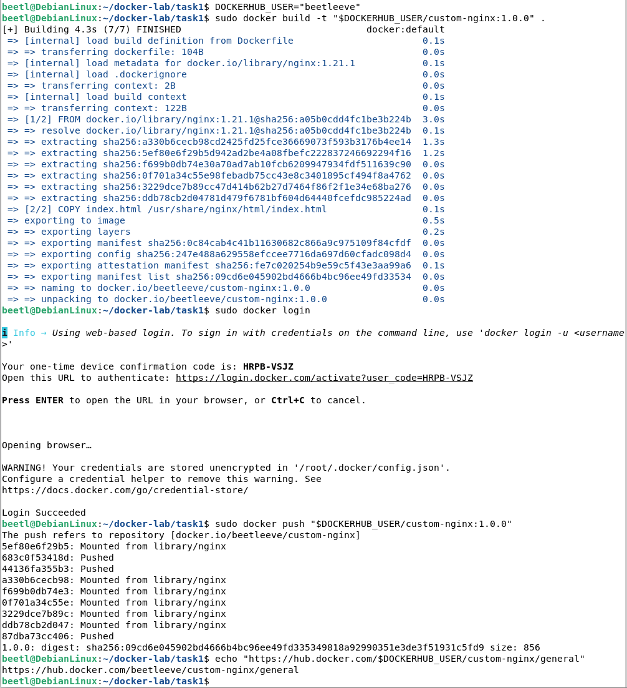
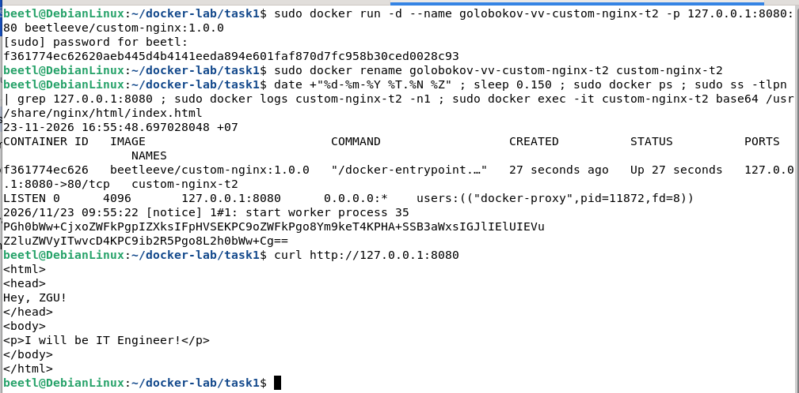
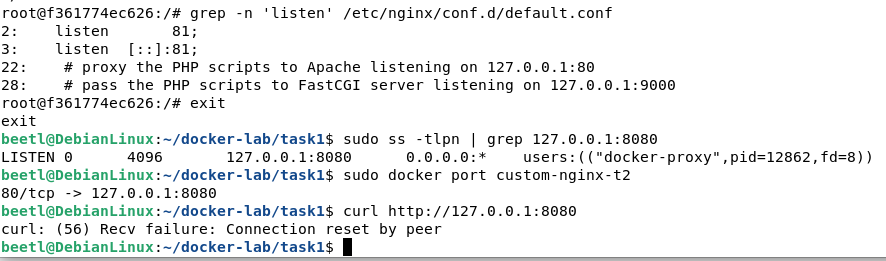
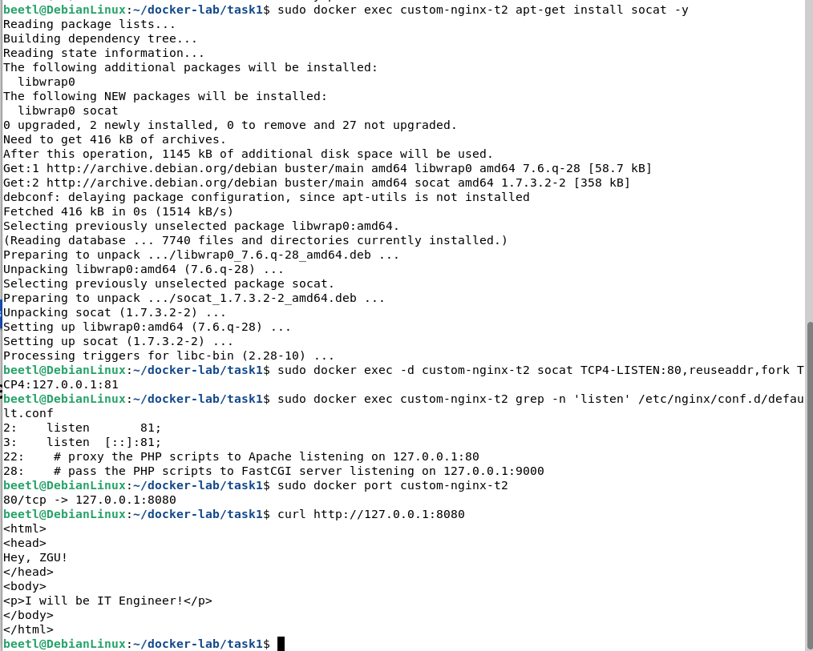
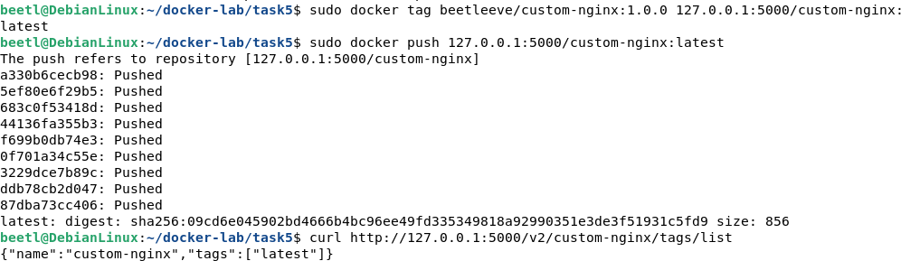
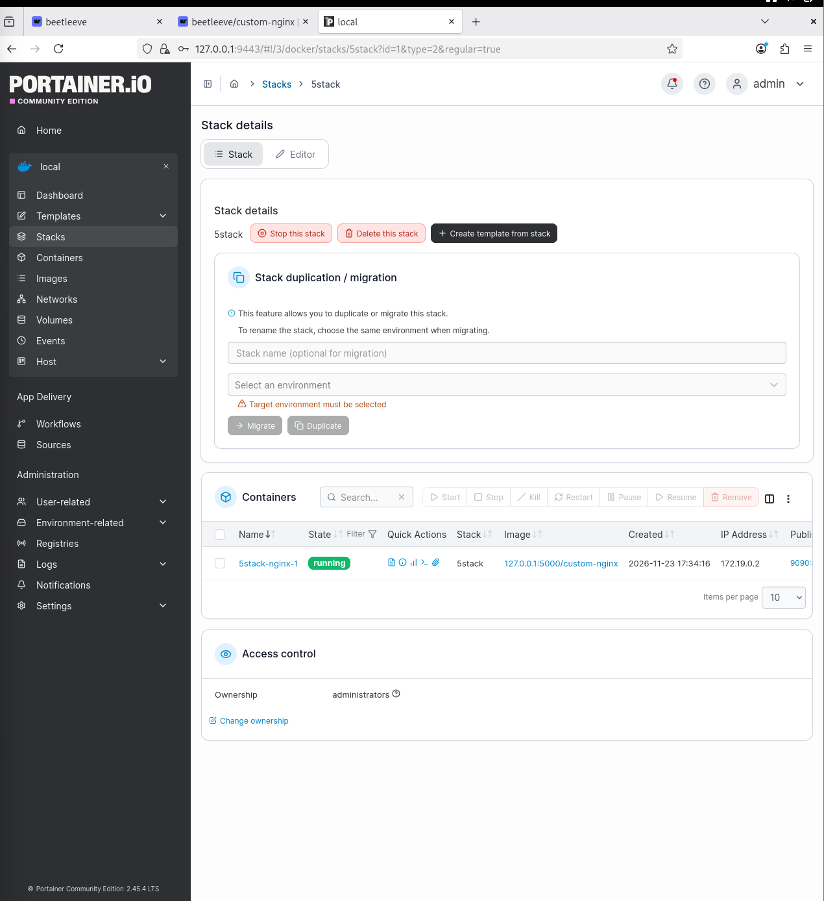
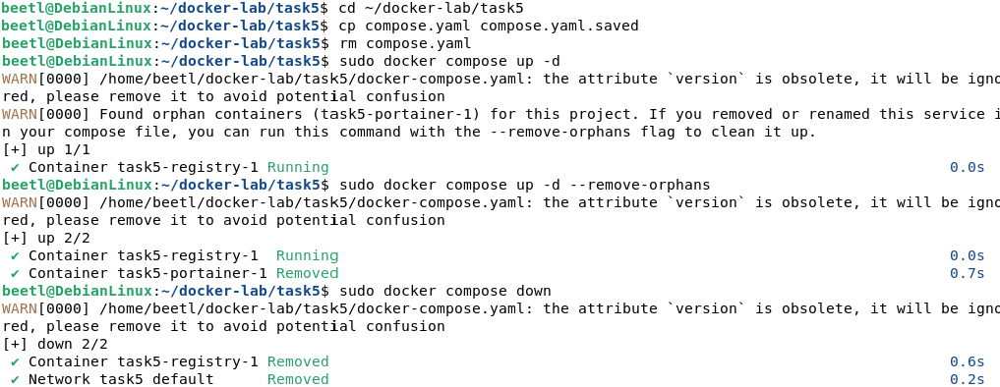

# Лабораторная работа по Docker

## Задача 1

[Образ на Docker Hub](https://hub.docker.com/r/beetleeve/custom-nginx)

## Задача 2

## Задача 3

После Ctrl+C nginx получил SIGINT и завершился. Вместе с основным процессом остановился контейнер.

Nginx слушает порт 81, а Docker перенаправляет запросы с 8080 на порт 80 контейнера. Поэтому страница недоступна.

### Дополнительный пункт 11

Через socat настроено перенаправление с порта 80 на 81 внутри контейнера. Страница снова доступна; nginx и проброс Docker не изменены. После остановки контейнера socat нужно запускать заново.

### Удаление контейнера

## Задача 4

## Задача 5

### 1. Выбор файла

Запущен compose.yaml: при наличии обоих файлов Compose выбирает его. Второй файл автоматически не подключается.

### 2. Подключение через include

[compose.yaml](compose.yaml)

### 3. Локальный registry

### 4–5. Portainer и стек

### 6. Inspect

### 7. Завершение проекта

После удаления compose.yaml в конфигурации остался только registry. Portainer стал orphan-контейнером и удалён с --remove-orphans. Проект погашен одной командой docker compose down.