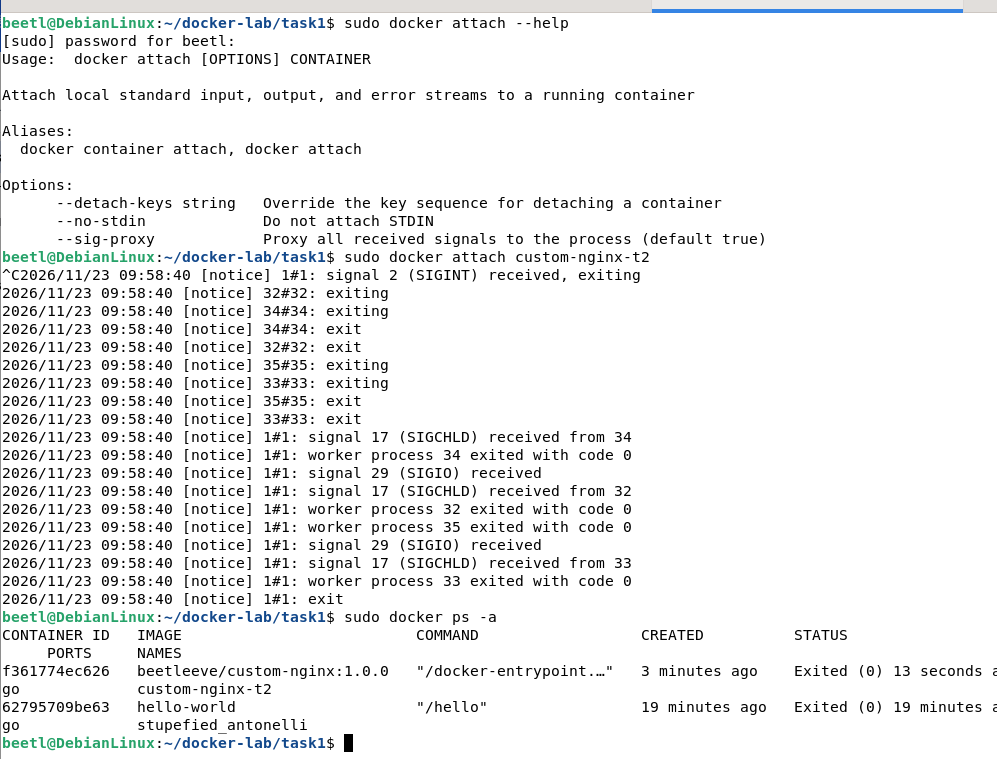
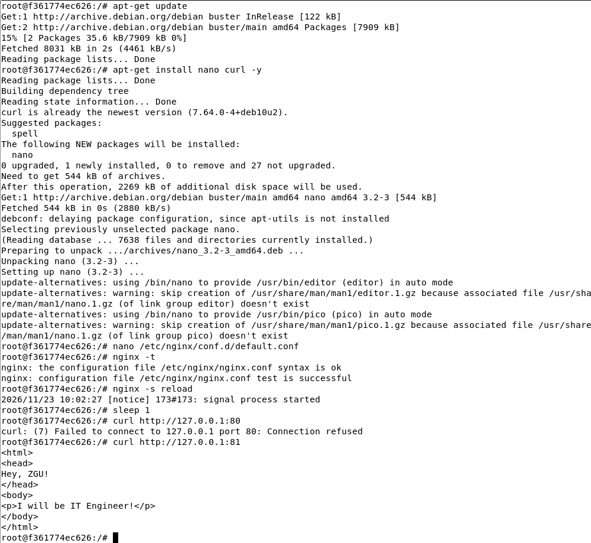
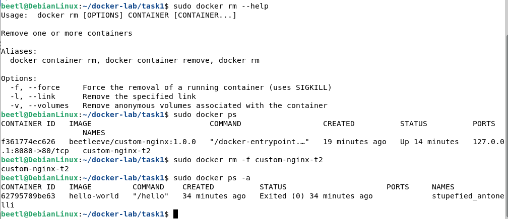
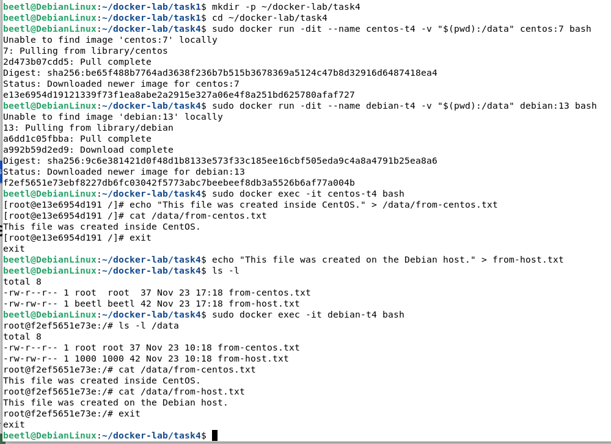
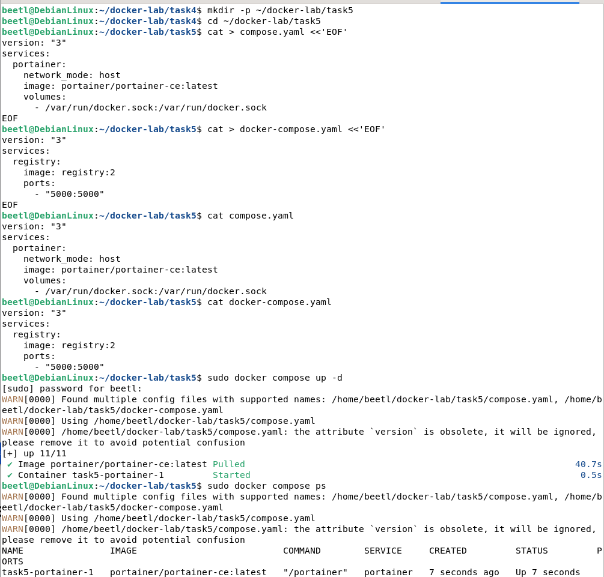
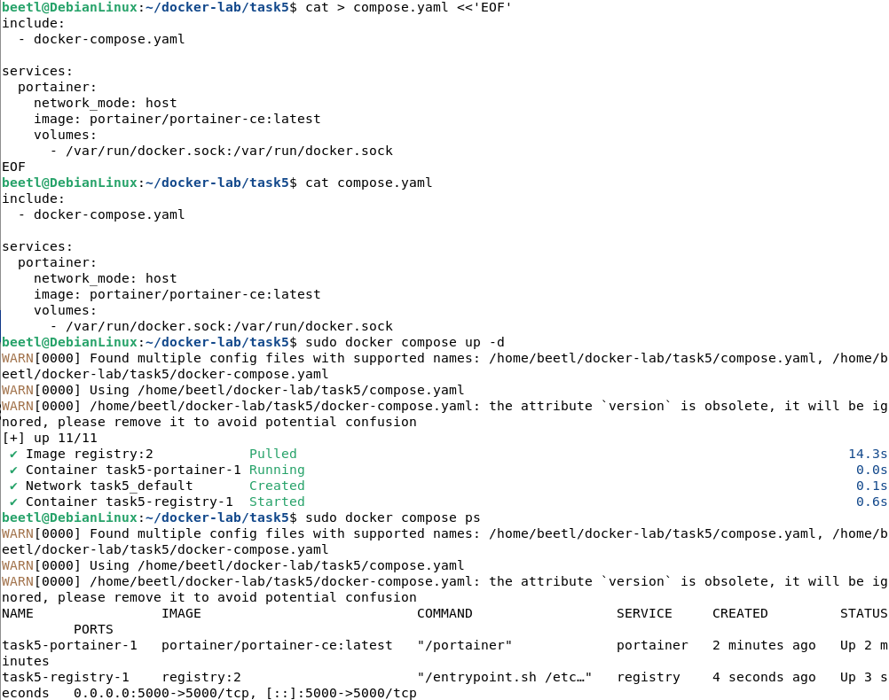
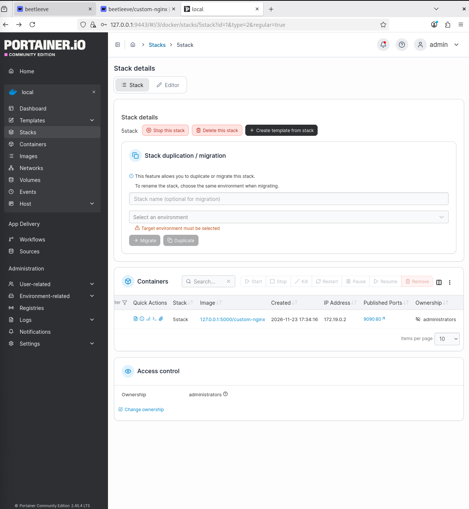
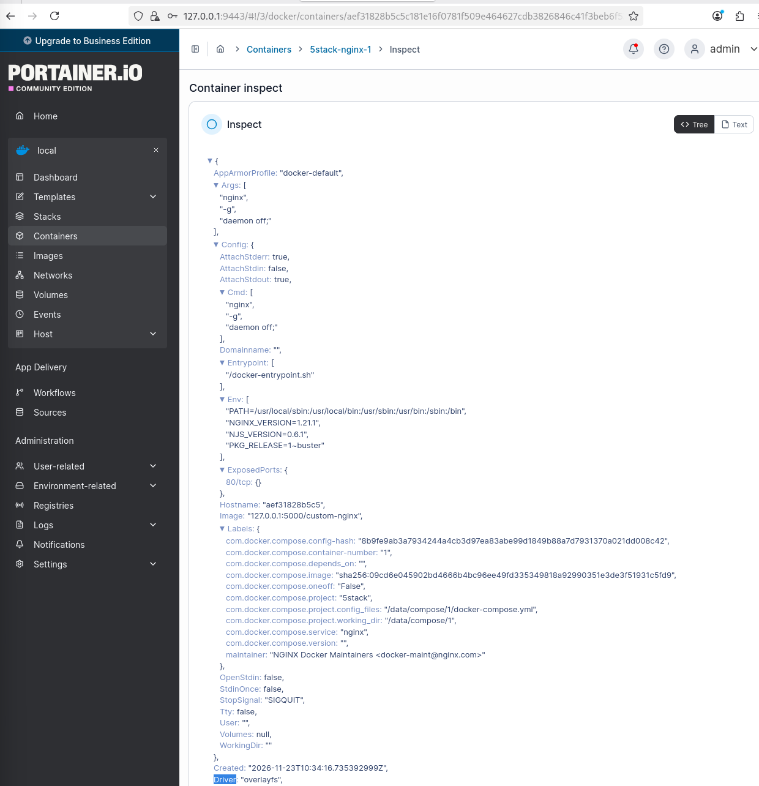

# Лабораторная работа по Docker

## Задача 1

[Docker Hub](https://hub.docker.com/r/beetleeve/custom-nginx)

## Задача 2

## Задача 3

Nginx слушает порт 81,Docker перенаправляет запросы с 8080 на порт 80 контейнера. Из-за этого страница недоступна.

Через socat перенаправляется с 80 на 81 порт внутри контейнера. Страница доступна, но после остановки контейнера socat нужно будет запускать опять.

## Задача 4

## Задача 5

Запущен compose.yaml при наличии обоих файлов Compose выбирает его. второй файл не подключается.

[compose.yaml](compose.yaml)

### 5.3

### 5.4

### 5.5

### 5.6

### 5.7

